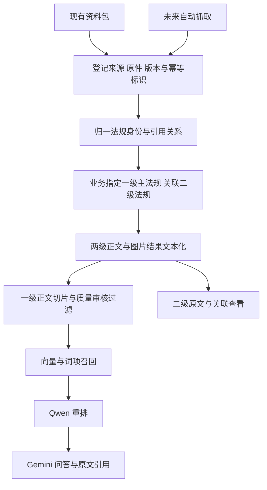

# 印尼法律资料结构与下游接入设计

研究日期：2026-10-11。资料包标注的交付日期为 2026-10-09。

这批资料已经包含原件、结构化正文、识别记录、脚注、译文对应和部分法规关系。建议先建立包格式适配器，校验并导入这些成果，再对新增文件、识别缺口和质量疑点调用解析及图片识别模型。以后自动抓取只需产生同样的接入记录，即可复用下游处理。

本页记录已核对的资料结构、用户确认的分级和后续实现边界；批量导入、法规分级、图片任务和重排尚未接入业务服务，不代表本包已完成入库或向量化。

## 已确认的一级与二级定义

- 一级资料：业务指定的主法规。
- 二级资料：主法规引用或关联的其他法规。
- 两级都需要文本化；一级资料建立向量索引并进入 RAG。

这是法规之间的业务关系。网页与下载文件、正文与附件、原文与译文、原件与图片分别使用自己的关联关系。当前 `documents.parent_id` 表示主文件与附件，不能直接承担法规之间的引用关系。

同一法规可以关联多个主法规，也可能在另一个业务范围内被选为一级。因此原件和正文只保存一份，级别绑定资料集或业务配置；具体一级名单由业务配置指定。包中的“默认检索”标记及 18 份中文译稿名单都不能自动成为一级名单。

## 资料包结构

来源：[学长提供的资料包](https://gofile.io/d/f8MTGggX)。ZIP 名称为“印尼法律资料_最终交付包.zip”，内部根目录为“印尼法律核心资料_核心中文整理版”。

ZIP 长度为 1,759,620,855 字节，目录包含 1,614 个文件。以下数量中，文书、原件、版本、脚注和关系清单已经完整读取；正文总数取自包内交付统计，正文内容采用抽样检查。

| 内容 | 数量或结构 | 接入用途 |
| --- | --- | --- |
| 文书目录 | 372 份逻辑文书，17 个主题 | 法规身份、名称、文号、机关、来源与分类 |
| 原件清单 | 578 个去重原件：556 PDF、21 HTML、1 XLSX | 内容 hash、来源链接和实际交付路径 |
| 原件目录 | 584 个文件 | 578 个清单原件，另有 6 个官网整页保留件 |
| 法律版本 | 560 条 | 包内规范化版本身份与原件对应 |
| 来源记录 | 687 条 | 来源文书身份、下载地址、详情地址与原件对应 |
| 来源身份合并 | 535 条 | 来源别名到规范化文书身份 |
| 条款及段落 | 包内统计 95,914 条 | 法条、段落、表格行、原文定位 |
| 法律正文默认检索 | 包内统计 67,980 条 | 上游清洗后的检索候选集合，仍需再按一级范围筛选 |
| 独立脚注 | 821 条 | 原注号、原文及对应条款 |
| 修改废止及状态关系 | 1,302 条 | 已有关系证据；并非完整的正文引用图谱 |
| 相同条款不同来源对应 | 2,209 条 | 保留来源，避免重复召回 |
| 页面状态 | 48,856 条，对应清单记录的 PDF 页数 | 页级识别、清洗、质量与定位信息 |
| 识别与清洗 | 556 个按原件 hash 命名的压缩 JSON | 原生文字、OCR、清洗结果、行号和坐标 |
| 译文与原件对应 | 96,735 条，覆盖正文与脚注 | 译文单元与原始记录绑定 |
| 验收图片 | ZIP 中有 216 个 PNG | 原页核对和更正证据；需补统一图片资产映射 |

主要入口是 `02_材料目录.xlsx`、`数据/*.jsonl.gz`、`识别与清洗/*.json.gz`。Excel 的 13 个工作表包含文书目录、逐份处理状态、页级异常、脚注、法规关系及茶叶税率；不含统一的一级或二级字段。

`中文阅读/` 是阅读产物；`中文译文/` 是译文与修订数据；`专项数据/` 含关税、原产地等结构化数据。正文文本化不等于中文翻译：这批资料同时有印尼文、英文和中文，全库中文并未完成，包内明确记录人工法律审校未完成。

## 可以直接使用的映射

| 层级 | 包内关键字段 | 导入规则 |
| --- | --- | --- |
| 逻辑法规 | `doc_id`、`source_doc_ids`、文号、年份、机关 | 使用来源命名空间保留外部 ID；通过别名表归一身份 |
| 物理原件 | `file_id`、`sha256`、`delivery_path`、`doc_ids` | hash 去重，支持同一文件关联多份文书 |
| 不可变原文版本 | `doc_id`、`source_sha256`、`version_id`、语种 | 版本清单单独导入，保留原始版本别名；不把下载先后视为法律效力先后 |
| 正文单元 | `record_id`、`doc_id`、`source_sha256`、`text` | 保留记录身份及原文；表格、正文、说明分别记录 |
| 原文位置 | `pdf_pages`、`source_line_ids`、HTML 定位、`sheet_name`、`excel_row` | 按格式保存定位，PDF 物理页与印刷页分开 |
| 脚注 | `footnote_id`、`record_ids`、`footnote_refs` | 关联原条款；切片与引用不能丢失脚注 |
| 译文 | `source_record_id`、`translation_unit_ids` | 保留原文与译文的一对多关系及翻译状态 |
| 法规关系 | 来源文书、目标文书、关系种类、原始证据 | 保存关系方向、适用范围、证据地址或页码及解析状态 |
| 图片识别 | 原件 hash、PDF 页码、行坐标、旧图片路径 | 补稳定资产 ID，绑定实际交付图片或待生成的原页裁剪 |

已发现 3 个原件关联多份文书：两个关联 2 份文书，一个关联 3 份。只用单一父文件字段会丢失这种关联。

关系文件混合使用两套字段：`source_doc_id / target_doc_id / relation` 和 `from_doc_id / to_doc_id / relation_type`，必须归一后使用。归一来源别名后，1,302 条关系中有 463 条的两端都能在本包文书目录找到；431 条的目标不在目录内，其中 6 条没有目标 ID。外部引用要保存为待解析或待补采，不能生成假目标或丢弃关系。

原件清单中的旧 `version_id` 与法律版本表的规范化 ID 不是同一套值，不能直接作为同一个外键。另有 22 个原件没有法律版本表记录，需要通过文书身份、原件 hash 和语种建立明确的版本绑定，不能静默跳过。

目录中全部 578 个原件的交付路径均能在 ZIP 中找到；文书清单引用的原件 hash 也均能匹配。解包后应使用 `delivery_path`，原始 `work/`、`outputs/` 等路径只作来源历史保存。

## 文本和图片处理

已存在的正文、脚注与清洗结果应经校验后导入，保留来源处理版本。新文件和确需重处理的页面走受限解析进程；一级和二级都可以产生正文，是否建立索引由独立的业务规则决定。

图片记录应至少包含原件 hash、文档版本、物理页、裁剪区域、坐标单位、图片 hash、关联正文单元、模型和处理版本、全文转录、识别摘要及疑点。没有页面尺寸或坐标单位时保留原始值及缺失状态，不伪造归一化坐标。

图像任务先登记映射，再调用 Gemini，结果按图片及文档版本回填。区分“无文字”“待识别”“部分识别”“识别失败”和“完成”；超时、截断或无效 JSON 不能记作完成。识别结果更新后，仅使受影响的正文与一级索引失效，保留历史处理结果。

GEO-System 可参考以下实现，并保留其来源和许可要求：

- `document_ingestion.py` 的 `ParsedElement`、`ParsedAsset`、章节切片、表格处理和 locator。
- `image_vision.py` 的图片邻近上下文、视觉事实与推断区分、结构化输出校验、重试与检查点。
- AItea 已抽取的 `backend/app/vendor/geo_parser/` 与受限入口 `parse_bounded`。

GEO 的图片结果偏重摘要，并会将临时 OCR 全文置空。法律资料文本化需要另存完整转录、原始 OCR、清洗文字及更正证据，不能只复制该摘要流程。参考项目 `tmp/GEO-System` 保持只读，不作为运行依赖。

已核对的具体缺口：

- 3 页图文识别异常分布在 2 个原件中，应继承现有检索排除状态；1 份双页拼版副本也已被上游排除默认检索。
- 21 个翻译单元另有原图核对更正，需要与原始识别文字并存，不能在导入时覆盖或遗漏更正。
- 原图片引用存在旧路径。两个 `finish-review/...` 引用在交付目录中能找到同名图片；`qc-images/pmk224-annexB-558.png` 未在 ZIP 清单中找到同名文件，需要进一步核对更名映射或从原件补出，不能生成失效图片链接。
- 抽样正文中存在为表格结构保留的空文本记录，应保留结构但不向量化空串。不同记录类型的字段并不完全一致。

## 下游流程建议

推荐“统一接入记录 + 两种入口适配”的实现：现有包导入和未来自动抓取共用原件登记、身份归一、关系、解析、图片任务及索引。全量重解析会丢失已核对成果并重复消耗模型；只将 PDF 逐份上传则无法保留本包的版本、条款、脚注及法规关系。

建议按以下边界实施：

1. **法规身份和关系。** 增加法规、原件关联、版本别名、法规关系和业务一级名单的持久化结构及升级逻辑。包内关系优先导入；正文中新识别的引用先保存原句、位置和候选目标，不能只按题名相似自动确认。
2. **批量导入与处理状态。** 先预检文件清单、hash、字段及关系覆盖，再分批事务写入。按批次、来源身份、原件 hash 和处理版本保证重复导入不增生，支持失败项重跑。不得执行包内采集脚本或直接覆盖业务数据库。
3. **两级文本化和图片回填。** 导入现成的正文、脚注、识别、译文及更正；缺口交给受限解析器和图片模型。正式附件、来源快照与译文用独立文件关联，不被误当成二级法规。
4. **一级 RAG。** 在业务选定一级范围内，按实际版本、质量与审核状态筛选切片，持久化真实向量、模型、维度与索引版本；进行词项和向量融合后再重排。二级正文可沿关系查看，默认不加入独立检索及模型回答上下文。若以后需要回答时展开二级原文，应另行定义可用范围、深度和证据规则。
5. **接入可视化。** 展示一级名单、二级关系、缺失目标、文本与图片处理状态、向量状态、重试入口及可回到原件的引用。自动抓取以后向同一入口提交新版本即可。

包内 `default_full_text_search`、`included_in_default_legal_search` 和“验收通过”是来源数据，不能替代 AItea 的法规审核。实际召回应同时满足账号与业务归属、一级选择、原件版本、文本质量、审核状态及适用日期；检索返回的每个片段须绑定原件 hash、版本和 locator。

目前上传流程限制单文件 20 MB、PDF 300 页。这批原件有 19 份超过 20 MiB、45 份超过 300 页。批量路径需要分块和按页受限处理，不能简单放开上传限制。当前检索只读取最近 500 份主文件，并在请求内展开 JSON manifest、计算全部候选向量相似度；应改为持久化的切片查询与索引任务，避免遗漏或每次装载整库。

若暂按 67,980 条候选记录各存一个 2,560 维 float32 向量估算，仅向量数值约 664 MiB，尚不含索引和元数据。实际数量以一级选择、去重及最终切片为准，不应将向量继续无界堆进单文件 JSON manifest。

## 模型配置与已验证范围

接口说明：[用户指定的开发接口教程](https://aerisun.top/sub2api/api-guide.html)。当前服务根地址为 `https://aerisun.top/sub2api`。

| 用途 | 模型 | 本轮真实调用 |
| --- | --- | --- |
| 问答及图片识别 | `gemini-3.8-flash` | 文本连通成功；图片核对样本完整读取 3 组 PDF 物理页与印刷页 |
| 文本向量 | `qwen3-embedding-4b` | 两段文本成功返回有限数值的 2,560 维向量；AItea 现有 `embed_texts` 封装也已真实调用通过 |
| 检索重排 | `qwen3-reranker-4b` | 两个候选成功评分，相关文本排在无关文本之前 |

图片试调用在 `max_tokens=500` 时返回 `finish_reason=length` 和截断 JSON；保持同一图片与提示，仅将上限改为 2,048 后返回完整 JSON。图中物理页 4、41、53 分别对应印刷页 4、41、11，结果与图片检查一致。该测试证明这一样本的图片输入和结构化结果可用，不代表复杂扫描页、表格或全量法律文本的识别质量已经验收。

密钥和模型设置保存在被 Git 忽略的项目根 `.env`，权限为 `0600`，文档不保存密钥。现有业务服务已读取 `LLM_*` 和 `EMBEDDING_*`；`RERANK_*` 仅为后续接线预置，当前业务代码尚未消费。未重启运行中的服务。

本轮完成了 ZIP 全目录检查，完整读取主要身份及关系清单，核对 578 个原件交付路径；另抽取正文 4,534 条、默认检索正文 969 条，检查一份原件及其识别结果，并核对该原件 SHA-256。正文样本来自压缩流前部，不是随机样本，不能用于估计全库质量。未下载并逐一核验全部原件，未执行全量导入、全量向量化、逐条法律审校或生产容量验收。

当前实现边界继续见 [文档解析与采集](INGESTION.md)、[架构](ARCHITECTURE.md) 和 [接口契约](API_CONTRACT.md)。落实新分级时需同步这些文档、数据库升级、后端模型、前端类型与交互，覆盖重复导入、关系缺口、跨账号访问、版本冲突、图片截断重试和二级不进入一级索引等行为。
